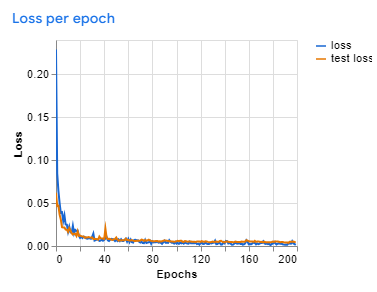
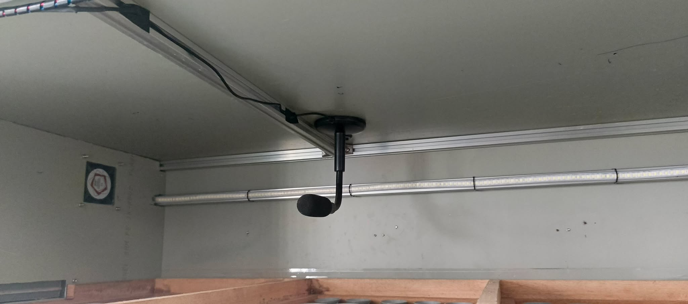

# AI Model
The AI model used for real-time egg fertility detection is based on YOLOv8n, achieving an accuracy of 0.98 (where 1 is 100% accuracy). We trained the model using a custom dataset captured during the construction of the incubator.

# Hardware Setup
Raspberry Pi
Model: Raspberry Pi 4B (8GB)
OS: Raspberry Pi OS Bookworm
Web Camera: Used for real-time fertility detection.
Microphone: Any microphone connected to the Raspberry Pi (we use the DM-717 microphone).

# Arduino Components
IR Speed Sensor
Ultrasonic Sensor (for water monitoring with the humidifier)
5V LED Light
DHT22 (for temperature and humidity monitoring)
Humidifier Fans
DC Motor (for tilting the trays)

# Camera Control
The Raspberry Pi controls the position of the camera using a Nema 17 stepper motor and a switch that places the camera at either the home or end position of the incubator, similar to how 3D printers work.

# Microphone and Hatching Detection
The system uses a DM-717 microphone to detect if the eggs have hatched. The microphone's sound data is processed and trained using TensorFlow to distinguish between background noises and chickling sounds. This allows the system to accurately detect when the eggs have hatched and trigger mobile notifications.

# Mobile Notifications
Notifications are sent to your mobile device using Firebase whenever a key event occurs, such as an egg hatching or a change in incubator conditions.
